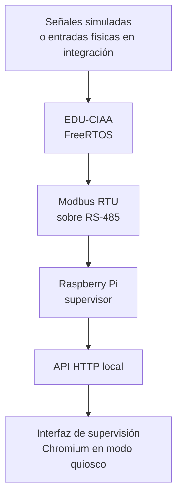

# BPGA | Banco de Prueba de Generadores Aeronáuticos

**Demostrador educativo de adquisición, comunicación y supervisión.**

<!-- Pendiente: incorporar una fotografía actual del demostrador BPGA sin datos personales. -->

## Descripción general

El BPGA es un demostrador educativo que reproduce, a escala, principios de funcionamiento y supervisión de un banco de pruebas de generadores aeronáuticos. La versión actual integra una EDU-CIAA con una Raspberry Pi para procesar, comunicar y visualizar variables mediante una interfaz de supervisión.

Un banco de pruebas permite observar el comportamiento de un generador fuera de la aeronave y bajo condiciones controladas. El BPGA toma ese principio como referencia y lo adapta a los recursos disponibles en la institución, integrando conocimientos de máquinas eléctricas, instrumentación, sistemas embebidos, comunicaciones industriales y software.

La implementación operativa se concentra actualmente en la plataforma digital. La EDU-CIAA ejecuta tareas en tiempo real y genera las variables del **Modo Simulador**. Los datos se transmiten mediante Modbus RTU sobre RS-485 hacia una Raspberry Pi, que actúa como supervisora y presenta la información en una interfaz local.

La etapa de potencia permanece desenergizada durante la demostración. El motor, el generador y las cargas no se conectan a  220 V. Así se pueden presentar el procesamiento de variables, las comunicaciones, los diagnósticos y la interfaz sin energizar el conjunto.

El BPGA no es un equipo de ensayo aeronáutico certificado. Es una plataforma educativa y evolutiva, preparada para incorporar progresivamente sensores físicos, regulación de excitación, cargas, protecciones y la operación controlada del conjunto motor-generador.

## Qué demuestra la versión actual

- Generación de variables simuladas dentro de la EDU-CIAA.
- Organización de tareas de tiempo real mediante FreeRTOS.
- Comunicación Modbus RTU sobre RS-485.
- Supervisión desde una Raspberry Pi, con API HTTP local e interfaz en Chromium.
- Monitorización, diagnóstico y seguimiento de resultados sin energizar la etapa de potencia.

## Arquitectura actual

La demostración actual utiliza principalmente señales generadas por la EDU-CIAA. La adquisición física de señales se integra de forma progresiva; el diagrama no implica que todos los sensores estén instalados u operativos.

## Modos de funcionamiento

### Modo Simulador

Es la base principal de la demostración actual. La EDU-CIAA genera las variables y estas recorren la cadena de Modbus, supervisor, API e interfaz. Este modo permite probar la arquitectura sin energizar la etapa de potencia.

### Modo Real

Está destinado a la adquisición de entradas físicas y su integración es progresiva. Una posible demostración parcial de RPM mediante giro manual queda sujeta a validación. Esto no significa que el motor o la etapa de potencia estén operativos, ni que actualmente se midan físicamente tensión y corriente.

## Interfaz de supervisión

La interfaz ofrece las pantallas **Monitor**, **Diagnóstico**, **Arquitectura** y **Resultados**. Se navega con las flechas izquierda y derecha; la tecla **Home** vuelve al Monitor.

También presenta máximos de RPM, tensión, corriente y potencia, muestras procesadas y tiempo de sesión. Detecta datos sin cambios de forma sostenida durante 800 ms, señala la pérdida de comunicación después de 2 segundos y permite observar su recuperación automática.

## Estado del desarrollo

### Implementado y validado

- Firmware de la EDU-CIAA organizado mediante tareas FreeRTOS.
- Modo Simulador.
- Comunicación Modbus RTU sobre RS-485.
- Supervisor en Raspberry Pi y API HTTP local.
- Interfaz en modo quiosco con pantallas de monitorización, diagnóstico, arquitectura y resultados.
- Detección de datos congelados y de pérdida de comunicación, con recuperación automática.
- Prueba integral de estabilidad de treinta minutos de la plataforma digital.

### En integración o validación

- Recepción GPS mediante el poncho L86: conectado a USART3, con recepción UART y de sentencias RMC validada.
- Sincronización del RTC, pendiente de recibir una sentencia RMC con estado válido. No se utiliza 1PPS y el GPS todavía no forma parte del mapa Modbus.
- Posible adquisición física de RPM mediante movimiento manual, sujeta a validación.

### Trabajo futuro

- Sensores reales de tensión y corriente e integración completa del sensor de RPM.
- Regulador de corriente de excitación y banco de cargas.
- Integración del PLC y de las protecciones.
- Alimentación segura del conjunto motor-generador y validación de la etapa de potencia.
- Integración de otras funciones del GPS, sin considerar el uso de 1PPS.

### Regulador de tensión

En un generador de corriente continua con excitación independiente, la tensión puede regularse actuando sobre la corriente de campo. El proyecto contempló representar la función de un regulador asociado a un generador aeronáutico de corriente continua; el subsistema fue estudiado conceptualmente, pero todavía no fue construido ni validado. No existe un lazo cerrado de regulación operativo.

## Prueba integral de estabilidad

La prueba integral obtuvo resultado técnico **APROBADO**, con 30 minutos de funcionamiento continuo (1800,06 s y 1801 registros):

- 0 interrupciones del servicio.
- 0 errores de API, datos inválidos y errores web.
- Temperatura máxima registrada en la Raspberry Pi: **58,50 °C**.
- Latencia media de la API: **8,49 ms**.

La prueba no registró secuencias repetidas ni regresiones reales. Los tres wraps observados correspondieron al retorno normal del contador.

Esta prueba valida la estabilidad de la plataforma digital bajo la configuración ensayada. **No valida la etapa electromecánica ni la etapa de potencia.**

Se pueden consultar los [resultados y evidencias](evidencias/prueba-integral-30m/) y el [script versionado de la prueba](raspberry-pi/tests/test_integral_30m.py).

## Alcance y seguridad de la demostración

> **La etapa de potencia permanece desenergizada. El motor no se conecta a 220 V y el generador y las cargas no funcionan energizados. El PLC aún no interviene en la operación. La demostración utiliza principalmente señales simuladas. El BPGA no es un banco certificado ni está habilitado para validar componentes aeronáuticos.**

## Tecnologías

- EDU-CIAA y FreeRTOS.
- Modbus RTU y RS-485.
- Raspberry Pi, Python y HTTP.
- HTML, CSS y JavaScript para la interfaz web.
- GPS L86, en integración.

## Documentación y recursos

- **Sitio público del proyecto (GitHub Pages):** en preparación.
- **Wiki técnica:** en preparación.
- **Código fuente:** [repositorio BPGA en GitHub](https://github.com/52-AV-2026-IMPA-TRQ/BPGA).
- **Pruebas y evidencias:** [prueba integral de 30 minutos](evidencias/prueba-integral-30m/) y [script de prueba](raspberry-pi/tests/test_integral_30m.py).

## Institución y carácter educativo

Proyecto educativo desarrollado en el ámbito de 5.º año de Aviónica de la E.E.S.T. N.º 7 IMPA TRQ durante el ciclo lectivo 2026.

## Licencia

El repositorio incluye una licencia MIT. Consultá el archivo [LICENSE](LICENSE).
